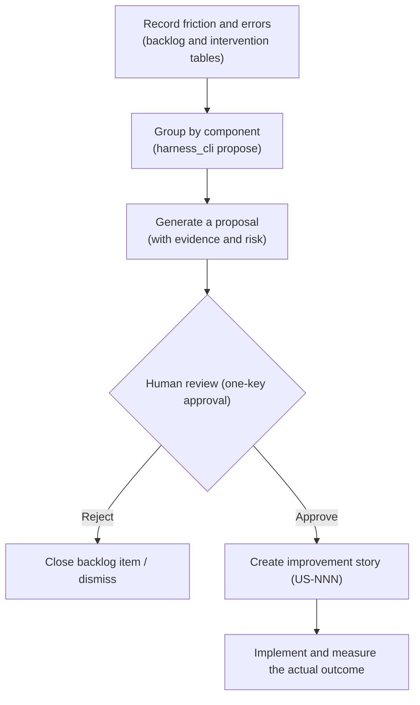

# IMPROVEMENT_PROTOCOL.md — Closed-Loop Self-Improvement Protocol (H5)

This document defines the loop **the machine proposes an improvement, a human approves it in one action, the actual outcome is measured**.

---

## 1. The closed loop

---

## 2. Invariants

1. **Never auto-apply:** every change to harness policy, schema or workflow **MUST** have human approval. The machine MUST NOT change its own code or rules without that control.
2. **Evidence-based proposals:** `propose` lists every component with open friction in the `backlog` table, with its count. Open an improvement story only when at least $2$ real friction or error records point at the same component.
3. **Outcome loop:** after resolving a proposal, the agent records the measured `outcome` on the backlog item (`harness_cli.py backlog close`) so the effect can be judged.
