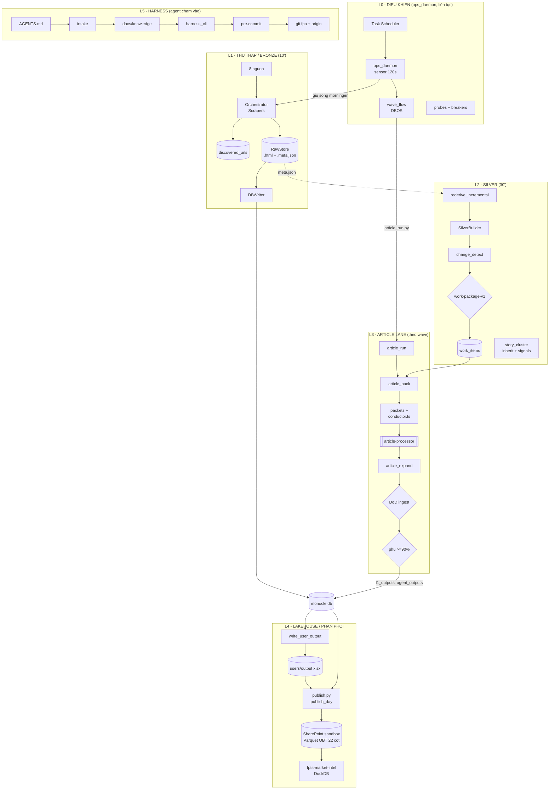
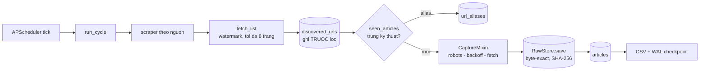
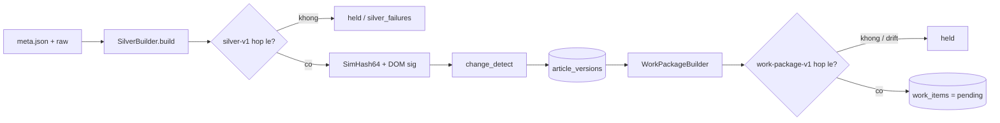
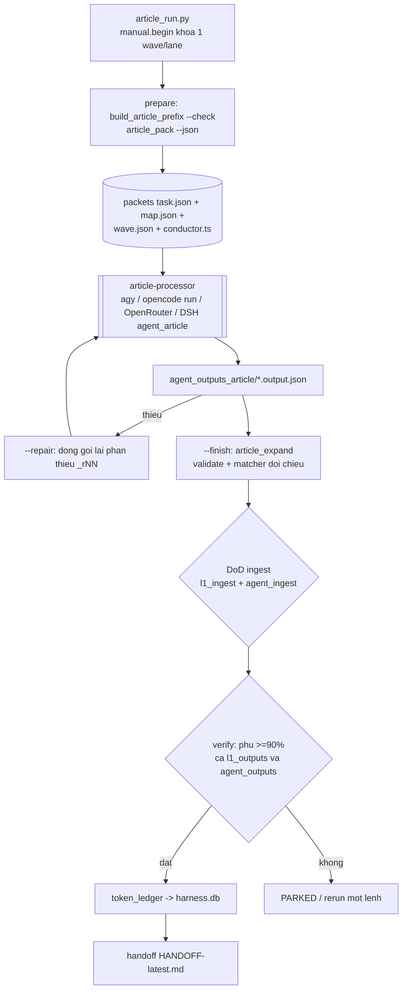
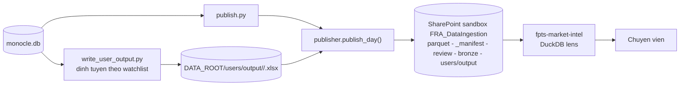

# Kiến trúc End-to-End — news-scape (6 lớp, Article Lane)

Cập nhật: 2026-10-21 · **Bản đồ cấp cao duy nhất** của toàn hệ thống, từ nguồn tin tới chuyên viên.
Phản ánh trạng thái hiện hành sau ADR-0010 (Article Lane là đường xử lý duy nhất), ADR-0023 (Lakehouse CQRS)
và ADR-0026 (chuẩn hoá runner, đường xuất bản, mức tự chủ, SSOT người dùng, cây `users/output`).
Đi sâu từng phần: bảng liên kết ở §12.
> Lane L1/Gold hai tầng cũ (`l1_route` → `agent_l1` → `agent_export` → `agent_gold`) đã nghỉ hưu (ADR-0010).
> Các tài liệu design 09, 10, 12, 17 mô tả lane đó là lịch sử; khi mâu thuẫn, tài liệu này thắng.

---

## 1. Triết lý kiến trúc

| Nguyên tắc | Diễn giải |
|-----------|-----------|
| **Medallion** | Bronze (raw WORM) → Silver (chuẩn hoá) → kết quả phân tích (`l1_outputs`, `agent_outputs`) → Lakehouse Parquet. |
| **Thu thập trọn vẹn, xử lý sau** | Lớp crawl không lọc theo độ giống, chuyên mục hay độ liên quan. Mọi URL có vết (ADR-0013). |
| **Producer ↔ Consumer** | Mã nguồn = producer (chụp, chuẩn hoá, đóng gói, nghiệm thu). Agent = consumer. Ranh giới là JSON Schema + DoD. |
| **WORM + tái dựng được** | Bronze ghi một lần, byte-exact. Mọi tầng dưới là hàm thuần của Bronze nên sửa parser không cần tải lại. |
| **Script 0 token ≠ Agent** | Script làm phần tất định. Ngữ nghĩa, thực thể, tóm tắt, hàm ý, trích dẫn chỉ do `article-processor`; không script nào giả lập (AGENTS.md §7.3). |
| **Provider-agnostic có thứ hạng** | Mọi runtime qua một hợp đồng đầu ra, một validator (ADR-0017). Thứ hạng ở §5. Claude không bao giờ là runtime thay thế. |
| **Ghi sổ, không chặn** | Token chỉ ghi `token_ledger`. Cổng thật của wave là kỹ thuật (DB ghi được, ingest sạch, phủ ≥90%). |
| **Một đường xuất bản** | `scripts/publish.py` → `src.export.publisher.publish_day()`; một chiều, chỉ sandbox (ADR-0023, ADR-0026). |

---

## 2. Toàn cảnh 6 lớp

Trục dữ liệu là `monocle.db` (SQLite WAL, ngoài repo). Mọi lớp L1–L4 đọc hoặc ghi vào đây.

---

## 3. L0 — Điều khiển và vận hành

**Entry (prod):** Task Scheduler `news-scape-ops` (lúc đăng nhập và mỗi 5 phút) chạy `scripts/ops_daemon.py run`; tác vụ `news-scape-ops-watchdog` kéo daemon dậy khi chết (`scripts/ops_install.ps1`).

| Thành phần | Vai trò | Đường dẫn |
|-----------|---------|-----------|
| `ops_daemon` | Sensor 120s, nhịp tim 60s, bản tin 08:00 và 18:00, `publish_tick` sau 01:00, Telegram, control room `127.0.0.1:8787` | `src/ops/daemon.py`, `scripts/ops_daemon.py` |
| `sensor` | Mở wave khi T1: ≥100 bài chờ; T2: bài cũ nhất >90' (06–22h); T3: khung flush | `src/ops/sensor.py` |
| `wave_flow` | Workflow DBOS: checkpoint từng bước, sống sót qua sự cố | `src/ops/wave_flow.py`, `src/ops/dbos_flow.py` |
| `CaptureSupervisor` | Giữ `python -m src.morninger` sống (tối đa 5 lần khởi động lại trong 30') | `src/ops/supervisor.py` |
| `breakers`, `probes` | Ngắt mạch theo provider (AUTH, QUOTA 300', NETWORK/TIMEOUT sau 3 lần, EMPTY sau 2); dò độ tươi, ghi DB, đĩa, dead-letter, độ phủ | `src/ops/breakers.py`, `src/ops/probes.py` |
| `pipeline_radar` | Chỉ đọc, in đúng một lệnh tiếp theo (zero-probe) | `scripts/pipeline_radar.py` |

**Mức tự chủ chỉ có hai (ADR-0026 sửa ADR-0012 D5):** `L0` = dừng/khoá, chỉ đo và báo; `L1` = mandate có hạn kèm trần số bài, đủ điều kiện thì mở wave và chạy trọn tới nạp DB. Không còn L2/L3. Khi daemon ở L1, không ai mở wave tay song song (`src/ops/manual.py::begin`).

Trạng thái vận hành nằm ở `ops.db` và `ops_dbos.db`, tách khỏi dữ liệu nghiệp vụ.

---

## 4. L1 — Thu thập (Bronze)

**Entry (prod):** `python -m src.morninger`. Một tiến trình, bốn job nội bộ; khoá `capture.lock` cộng khoá trong `pipeline_state` chống chạy trùng.

| Job | Chu kỳ | Hàm |
|-----|--------|-----|
| `capture` | 10' | `Orchestrator.run_cycle`, rồi `backfill_deferred.py`, rồi `capture_reconcile.py run` (tối đa mỗi 30') |
| `re-derive` | 30' | `pipeline.derive.rederive_incremental`, rồi cụm tin và tín hiệu |
| `drift report` | 06:00 | `pipeline.drift.list_drift` |
| `reclaim` | 30' | thu hồi `work_items` bị kẹt |

- **Nguồn đang bật (8):** cafef, fireant, tnck, baodautu, vietstock, vneconomy, vietnambiz, thoibaotaichinhvietnam (`config/domains/*.yaml`). Thêm nguồn = một module scraper + một YAML.
- **Sổ khám phá URL:** `src/db/registry.py`; trạng thái cuối chỉ `captured`, `alias`, `gone`, `dead_letter`. Không có trạng thái “bị bỏ”.
- **Đối soát và bù:** sitemap (cafef, tnck, baodautu, vneconomy) lệch >2%/ngày là ĐỎ (`src/pipeline/reconcile.py`); tải bù bài hoãn, khôi phục Bronze mất.
- **Bất biến:** `RawStore.save` ghi nguyên bản trước mọi xử lý, nguyên tử (`tmp` → `os.replace`); lần tải lại thất bại không ghi đè bản tốt. Chi tiết: [06-raw-html-capture](06-raw-html-capture.md).

---

## 5. L2 — Chuẩn hoá (Silver) và cụm tin

- **Driver:** `rederive_incremental` quét `meta.json` mới theo watermark `fetch_ts`; watermark không bao giờ vượt một lỗi chưa giải quyết; lỗi vào `silver_failures`, dead-letter sau 5 lần (ADR-0007). Bảo trì toàn bộ: `scripts/rederive_from_bronze.py`.
- **Change-detection (5 trạng thái):** `NEW`, `UNCHANGED`, `CONTENT_CHANGED`, `TEMPLATE_DRIFT`, `SELECTOR_BROKEN`. SimHash ở đây phục vụ phiên bản và drift, không phải bộ khử trùng.
- **Cụm tin (ADR-0016):** `story_cluster.py` tất định, không xoá bài. Bản sao chép nguyên (sha hoặc containment ≥0,95 cùng số liệu và mã) thừa kế kết quả bài gốc với `l1_source='inherited'`, giữ 48h trước khi thừa kế. Bài viết lại hoặc cùng sự kiện vẫn được phân tích đủ. `analytics/signals.py` dựng `signal_daily`, `entity_links`, `source_profile`.

| `work_items.status` | Ý nghĩa |
|---------------------|---------|
| `pending` | đã enqueue, chưa claim |
| `claimed` | đang xử lý |
| `done` | DoD đạt |
| `failed` | DoD không đạt (vĩnh viễn) |
| `held` | silver/package invalid, TEMPLATE_DRIFT, SELECTOR_BROKEN: không giao agent |

---

## 6. L3 — Article Lane (phân tích)

Một wave = một lần `run_code` (DSH) hoặc một lượt runner. Điểm vào duy nhất cho daemon lẫn người vận hành: `scripts/article_run.py`.

| Bước | Script | Việc |
|------|--------|------|
| prepare | `scripts/article_run.py`, `scripts/article_pack.py` | Chọn bài chưa phân tích (code_first không tính, thin bị loại, bản sao giữ 48h); tier 1 (watchlist, ngành liên quan, macro khẩn) đứng trước, tier chỉ quyết định thứ tự không quyết định độ sâu; chia batch (mặc định 50) |
| packets | `article_pack.py` | `article_<wave>_NN.task.json` `{d,n,a:[{i,t,p}]}`, mọi đoạn nguyên văn, ≤1.900 ký tự/dòng; `wave_<wave>.conductor.ts` |
| analyze | runner (§6.1) | Một lượt mỗi batch, không tool, temperature 0, seed cố định; trả `article-compact-v2` |
| repair | `article_run.py --repair` | Đóng gói lại đúng phần thiếu; `--batch` là cách duy nhất chia batch |
| expand | `scripts/article_expand.py` | Validate; đối chiếu thực thể bằng matcher (`BOTH` / `LLM_ONLY` / `CODE_ONLY`); dựng lại trích dẫn nguyên văn từ chỉ số đoạn; thoát 1 nếu >10% wave lỗi |
| ingest | `scripts/l1_ingest.py`, `scripts/agent_ingest.py` | Kiểm quyền ghi DB trước khi tốn token; DoD từng bản ghi; chỉ file của wave này |
| verify | `article_run.py` | Phủ ≥90% ở cả `l1_outputs` (code_first loại) và `agent_outputs`; đạt mới in dòng HOÀN TẤT, exit 0 |
| ledger, handoff | `scripts/token_ledger.py`, `scripts/handoff.py` | Ghi token (chỉ worker); `HANDOFF-latest.md` |

**Matcher danh mục** (`src/agent/entities.py`, `Capitalized Suffix Guard`, `Prefix Guard`) chỉ đối chiếu, không thay thế kết quả mô hình.

### 6.1 Thứ hạng runtime LLM (ADR-0026)

| Hạng | Runtime | Ghi chú |
|------|---------|---------|
| 1 | **agy runner** (`src/agent/agy_runner.py`) | Mặc định của daemon (`config/ops.yaml`); chuẩn đối chứng golden set |
| 2 | **`opencode run`** (`src/agent/opencode_runner.py`; `--runner opencode`; batch tay qua `scripts/opencode_native_run.py`, dọn tồn đọng qua `scripts/run_backlog_opencode.py`) | Chưa thuộc `PROVIDERS` của daemon (`src/ops/order.py` còn `agy`, `openrouter`) |
| 3 | **OpenRouter API** (`src/agent/openrouter_runner.py`) | Dự phòng; `--runner openrouter` |
| — | DSH `agent_article` | Đường conductor tương tác (`run_code`); cần cổng preflight 14 mục (rule 09) |

**Claude không bao giờ là runtime thay thế** của lane. Mọi runtime qua `src/agent/article_contract.py` và một validator; provider mới phải qua golden set (ADR-0017; bộ này chưa gán nhãn).

### 6.2 Hợp đồng dữ liệu

| Hợp đồng | Schema | Chủ |
|----------|--------|-----|
| `silver-v1` | `schemas/silver-v1.schema.json` | producer |
| `work-package-v1` | `schemas/work-package-v1.schema.json` | producer |
| `article-compact-v2` `{i,e,s,k,im,sn,ts,c}` | `schemas/article-compact-v2.schema.json` | agent (đầu ra) |
| `l1-entity-output-v1` | `schemas/l1-entity-output-v1.schema.json` | `article_expand` |
| `agent-output-v2-lean` | `schemas/agent-output-v2-lean.schema.json` | `article_expand` |

Các trường `materiality`, `event_type`, `impact_area` đã bị loại ở mọi lớp.

---

## 7. L4 — Phân phối và Lakehouse

- **Giao hàng:** `scripts/write_user_output.py` → `src/export/user_output.py`. Chỉ giao bài đã có kết quả L1 do mô hình phân tích (code_first không tính); Gold là tuỳ chọn (`GOLD` hoặc `L1_ONLY`). Định tuyến theo watchlist, lọc nhiễu macro, checkpoint chống gửi trùng.
- **Cây Excel:** `<DATA_ROOT>/users/output/<user>/<YYYY-MM-DD>.xlsx`, giống hệt cục bộ và trên SharePoint (ADR-0026). `paths.users_output_dir()` trả về `<gốc>/users/output`.
- **ĐƯỜNG XUẤT BẢN CHUẨN DUY NHẤT:** `scripts/publish.py` → `src.export.publisher.publish_day()`. Chỉ ngày đã đóng; staging → `.partial` → thay thế, không ghi đè; từ chối site `FRA` chính thức, chỉ sandbox `FRA_DataIngestion` (ADR-0023). Chạy hằng ngày qua `publish_tick` sau 01:00; backfill lịch sử bằng `publish.py --from/--to` (US-038).
- **`scripts/lakehouse_cli.py` chỉ là công cụ phụ trợ:** kiểm toán (`verify` manifest SHA-256) và cổng tiếp nhận dữ liệu ngoại vi (dropzone, `ingest`/`consolidate`). Không phải đường xuất bản chính thức.
- **Bố cục trên đích:** `parquet/articles/year=/month=/part-<ngày>.parquet` (OBT 22 cột, ZSTD), `_manifest/<ngày>.json` + `latest.json`, `review/monocle_review_<ngày>.db` (7 ngày), `bronze/YYYY/MM/DD/<nguồn>.tar.xz`, `users/output/`.
- **Tiêu thụ:** plugin `plugins/fpts-market-intel` (ADR-0025) dựng view DuckDB trong bộ nhớ trên Parquet, 12 skill phân tích.

**Người dùng nhận tin — SSOT duy nhất (ADR-0026):** `<DATA_ROOT>/subscriptions/manifest.yaml` quyết định bật/tắt người dùng; bản gieo mẫu trong repo `users/subscriptions/manifest.yaml`. `project/config/entities/manifest.yaml` đã khai tử. Watchlist đã biên dịch từng người nằm ở `project/config/entities/users/*.yaml`. Tra danh sách bằng `pipeline_radar.py users`; không chép vào tài liệu.

---

## 8. L5 — Harness (phần agent chạm vào)

| Thành phần | Vai trò |
|-----------|---------|
| `AGENTS.md` | Điểm vào duy nhất; ba tier TINY / NORMAL / HIGH-RISK; WIP=1 mỗi worktree (ADR-0022) |
| `docs/FEATURE_INTAKE.md`, `docs/CONTEXT_RULES.md` | Phân loại rủi ro, ngân sách ngữ cảnh |
| `docs/knowledge/`, `docs/INDEX.md` | Khung tri thức (ADR-0021): ADR, story, FACT, rule, run, runbook |
| `scripts/harness_cli.py` | `doc new/lint/index/sync`, `audit`, `propose`, `git`, `session close` |
| `harness.db` | story, intake, trace, backlog, decision, token_ledger (tách khỏi `monocle.db`, ADR-0002) |
| pre-commit | `git verify` + `doc lint --staged` |
| Git | Đẩy hai remote `fpa` và `origin` |
| `.agents/` | `registry.yaml`, `pipeline.yaml`, rule, skill, preset DSH |

Vòng thay đổi: đọc `AGENTS.md` → intake → story/ADR → proof → trace → đóng phiên. Mục tiêu cốt lõi là luôn theo dõi được trạng thái công việc; cổng chỉ chặn điều gây hỏng dữ liệu.

---

## 9. Bản đồ Artifact ↔ Schema ↔ Store

| Artifact | Schema / hợp đồng | Store | Chủ | Bất biến |
|----------|-------------------|-------|------|----------|
| Bronze raw | meta 14 khoá | `<DATA_ROOT>/raw_html/**` | producer | WORM |
| Silver | `silver-v1` | `<DATA_ROOT>/silver/**` | producer | tái dựng được |
| Version log | DDL | `article_versions` | producer | chỉ thêm |
| Work-package | `work-package-v1` | `<DATA_ROOT>/work_packages/**` | producer | tái dựng được |
| Catalog | DDL | `work_items` | chung | trạng thái đổi được |
| Packet wave | packet 1.0 | `<DATA_ROOT>/agent_tasks/article/**` | producer | tạm thời |
| Đầu ra mô hình | `article-compact-v2` | `<DATA_ROOT>/agent_outputs_article/**` | agent | tạm thời |
| Kết quả L1 | `l1-entity-output-v1` | `l1_outputs` | `article_expand` | qua DoD |
| Kết quả nội dung | `agent-output-v2-lean` | `agent_outputs` | `article_expand` | qua DoD, chỉ thêm |
| Excel người dùng | — | `<DATA_ROOT>/users/output/<user>/<ngày>.xlsx` | delivery-writer | một bản mỗi ngày |
| Lakehouse | OBT 22 cột | SharePoint `parquet/articles/**` | `publish_day` | một chiều, có manifest |

`url_title_hash` là định danh bài xuyên mọi tầng; `content_sha256 = raw_sha256` là khoá provenance và thay đổi.

---

## 10. Lịch vận hành hằng ngày

| Thời điểm | Việc | Chủ |
|-----------|------|-----|
| mỗi 10' | capture, backfill hoãn, đối soát sitemap | `morninger` |
| mỗi 30' | re-derive, cụm tin, tín hiệu, reclaim `work_items` | `morninger` |
| 06:00 | drift report | `morninger` |
| mỗi 120s | sensor: T1/T2/T3 → mở wave | `ops_daemon` |
| mỗi wave (100 bài, batch 50) | preflight → prepare → analyze → repair ×2 → finish → giao xlsx | `wave_flow` |
| 08:00, 18:00 | bản tin sức khoẻ | `ops_daemon` |
| sau 01:00 | `publish_tick` → `publish_day(hôm qua)` | `ops_daemon` |

Lệnh tay chính: `python -m src.morninger --once capture|derive|drift`, `scripts/run_once.py`, `scripts/article_run.py --wave <code> ...`, `scripts/publish.py --from <ngày> --to <ngày>`, `scripts/pipeline_radar.py status`.

---

## 11. Bất biến toàn hệ (checklist review)

1. Raw `.html` = byte-exact; `sha256(file) == content_sha256`; không bao giờ sửa.
2. Silver, version, package là hàm thuần của Bronze (không dùng `now()`), re-derive cho kết quả giống hệt.
3. Mọi URL phát hiện đều vào sổ khám phá trước mọi bộ lọc; không có trạng thái “bị bỏ”.
4. Trùng lặp là dữ liệu: có thể bỏ qua LLM, không xoá, vẫn được đếm.
5. Article Lane là đường xử lý duy nhất; không gọi `l1_route.py`, `agent_export.py`, `requeue.py`, `l1_ingest.py --code-first`.
6. Không script nào giả lập trí tuệ agent; `code_first` không bao giờ được tính là đã phân tích.
7. Mọi runtime qua một hợp đồng và một validator; Claude không phải runtime thay thế.
8. Token chỉ ghi sổ; không trần token nào dừng wave hoặc cắt batch.
9. Cổng của wave là kỹ thuật: DB ghi được, ingest không lỗi, phủ ≥90% hai lớp.
10. Một đường xuất bản chuẩn (`publish.py` → `publish_day`), một chiều, chỉ sandbox; ghi vào site `FRA` chính thức bị chặn trong mã.
11. Chỉ hai mức tự chủ L0/L1; khi daemon ở L1, không mở wave tay song song.
12. Một nguồn sự thật cho người dùng nhận tin; một cây `users/output` cho cả cục bộ và SharePoint.
13. Dữ liệu ghi nằm ngoài repo và ngoài OneDrive (`MONOCLE_DATA_DIR`, mặc định `C:\data\news-scape`).
14. WIP = 1 story mỗi worktree; bộ nhớ dự án nằm trong `docs/knowledge/`.

---

## 12. ADR và tài liệu liên quan

| Lớp | ADR chi phối |
|-----|--------------|
| L0 | 0009, 0011, 0012 (mức tự chủ: sửa bởi 0026), 0014 |
| L1 | 0013 (0015 bị bác bỏ) |
| L2 | 0007, 0016 |
| L3 | 0010, 0017, 0018, 0019, 0005 |
| L4 | 0023 (thay thế 0020), 0025, 0026 |
| L5 | 0001, 0002, 0006, 0021, 0022, 0024 |

| Tài liệu | Nội dung |
|----------|----------|
| [06 — raw capture](06-raw-html-capture.md) | Bronze, meta 14 khoá |
| [07 — storage + change-detect](07-storage-layers-and-change-detection.md) | Medallion, 5 trạng thái |
| [08 — handoff + catalog](08-handoff-contract-catalog.md) | work-package, exactly-once |
| [14 — entity system](14-entity-system-and-mapping.md) | Danh mục thực thể, matcher |
| [13 — per-user output](13-per-user-output-workflow.md) | Đăng ký và giao hàng theo người |
| `docs/decisions/0010-…`, `0017-…`, `0023-…` | Quyết định gốc |

Tài liệu 09, 10, 12, 17 là đặc tả lịch sử của lane L1/Gold; đọc kèm banner đầu trang.
